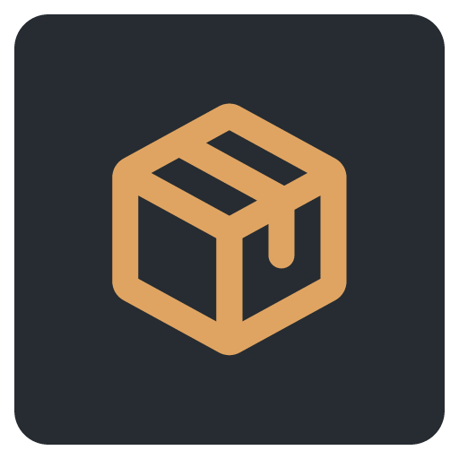
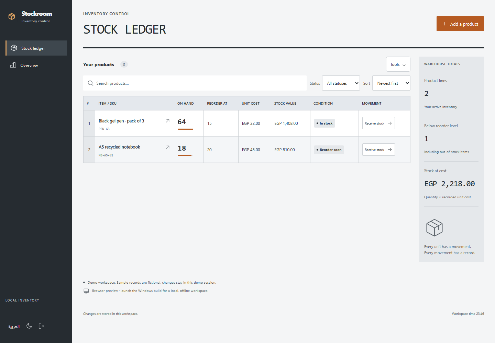
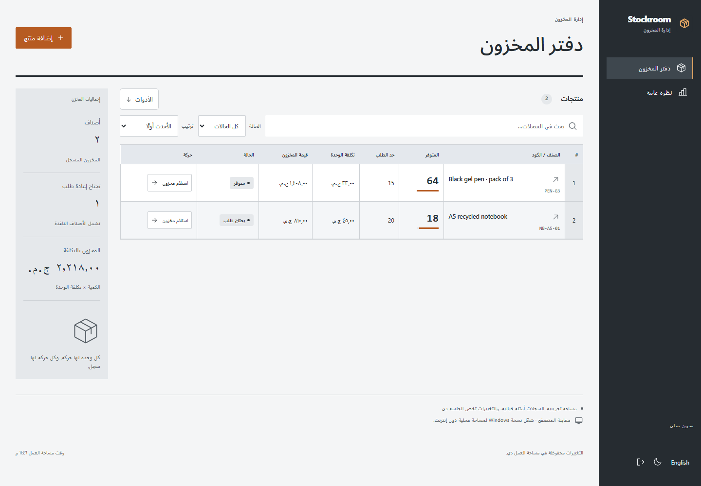
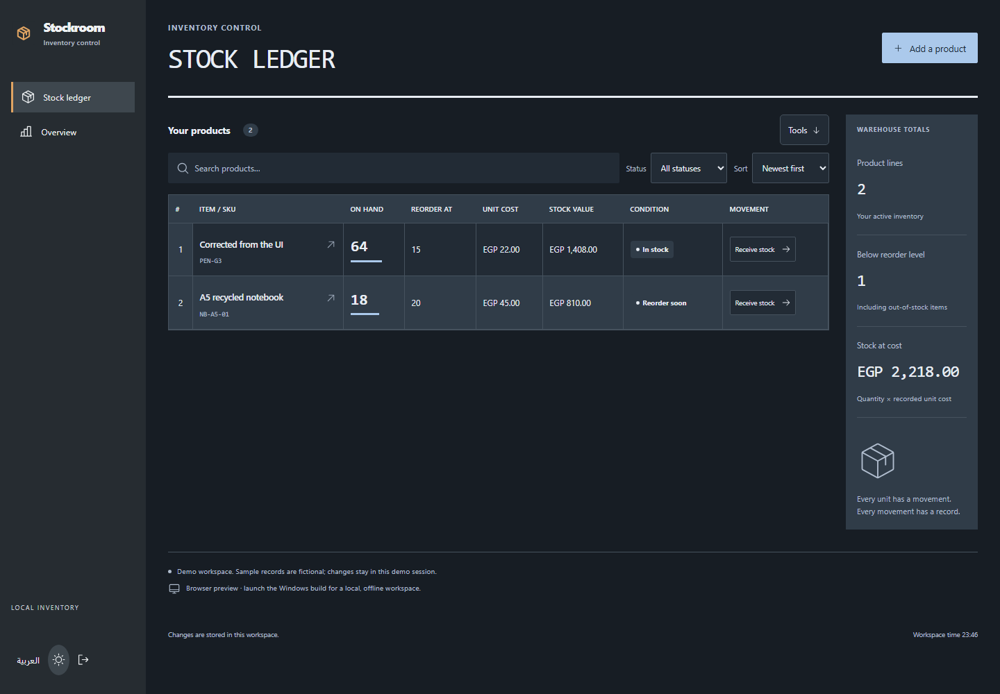

# Stockroom

`RECEIVE / ISSUE / REORDER / REVIEW`



Stock in. Stock out. A record for both.

**[Download for Windows](https://github.com/Ahmed-Khalil-Mohamed/stockroom/releases/latest)** · [العربية](#بالعربي) · [Report a bug](https://github.com/Ahmed-Khalil-Mohamed/stockroom/issues/new?template=bug_report.yml) · [Suggest an improvement](https://github.com/Ahmed-Khalil-Mohamed/stockroom/issues/new?template=feature_request.yml)



For a small shop or workshop tracking quantities without an enterprise inventory system.

[](https://github.com/Ahmed-Khalil-Mohamed/stockroom/actions/workflows/quality.yml) [](LICENSE) 

## Get the Windows app

Download **[Stockroom-1.1.0-windows-x64.zip](https://github.com/Ahmed-Khalil-Mohamed/stockroom/releases/download/v1.1.0/Stockroom-1.1.0-windows-x64.zip)**, extract the entire folder, and open `Stockroom\Stockroom.exe`. Keep the accompanying files next to the executable. Node.js is bundled; installing Node is only necessary for development.

[SHA256SUMS.txt](https://github.com/Ahmed-Khalil-Mohamed/stockroom/releases/download/v1.1.0/SHA256SUMS.txt) is supplied with the release. This is an **unsigned portable Windows x64 build**, tested on the development Windows machine; compatibility with every Windows configuration is not certified. There is no installer or automatic updater. Data stays in `%APPDATA%\Stockroom\workspace.sqlite`, separately from the browser preview. Copying the app folder does not copy that database.

GitHub's automatic source archives contain the complete development source; use the Windows ZIP to run the packaged application.

## The ledger behind the shelf

1. Add products with unique SKUs, opening quantities, reorder levels and unit costs.
2. Receive or issue stock with a reference for each movement.
3. Review the movement ledger, low-stock indicators and total recorded cost; export CSV for inspection.

## How the records stay consistent

- SKU uniqueness is scoped to the workspace and case-normalized.
- An issue cannot exceed available quantity, including under competing edits.
- Valuation is current quantity times the recorded unit cost, not FIFO accounting.

## More of the interface

<details>
<summary>Arabic workspace / الواجهة العربية</summary>



</details>

<details>
<summary>Dark workspace</summary>



</details>

Graphite navigation, industrial monospace title, dense ruled spreadsheet and a separate vertical warehouse readout. Wide tables scroll within their container on narrow screens.

Screenshots show the actual interface with fictional demonstration records. [Design notes](DESIGN.md) · [Image and icon provenance](ASSETS.md).

## Build the desktop app

Use **Node.js 24 or newer** and npm.

```sh
git clone https://github.com/Ahmed-Khalil-Mohamed/stockroom.git
cd stockroom
npm ci
npm run build
npm run desktop
```

Package with `npm run package:windows`; the complete output is `release/Stockroom/`. The first launch or packaging step downloads the pinned Electron runtime, unless already cached. The packaged app runs offline.

Each checkout owns its dependency lockfile, server, tests and SQLite storage. The browser process uses `data/stockroom.sqlite` and the `stockroom_session` cookie. [Deployment and backups](docs/DEPLOYMENT.md).

## Checks you can run

```sh
npm run format:check
npm run check
npx playwright install chromium
npm run test:e2e
npm audit
```

Integer quantities, nonnegative stock, duplicate SKUs, rollback, stale concurrent stock issues and UI validation. Local project results are in [VERIFICATION](docs/VERIFICATION.md).

The [Quality workflow](https://github.com/Ahmed-Khalil-Mohamed/stockroom/actions/workflows/quality.yml) runs on Windows and Linux. The badge above reports the live result. Local evidence, test counts and known validation limits are documented in [VERIFICATION](docs/VERIFICATION.md). Windows CI also packages the application and runs the native smoke check.

## Current boundaries

No barcode scanning, purchase-order integration, weighted-average costing, taxes, multi-warehouse stock, or accounting-system claims.

The sample records are fictional. Interview intended users and measure task completion before claiming proven impact. A useful next study is to compare the complete workflow with the person’s current spreadsheet or paper process.

## بالعربي

دفتر مخزون يعمل دون إنترنت للمحال الصغيرة، مع تنبيهات النقص وقيمة المخزون وسجل حركة.

بدّل اللغة من زر «العربية». البيانات التجريبية أمثلة وليست سجلات مستخدمين حقيقيين. [دليل التشغيل بالعربي](START-HERE-AR.md).

## Contribute and report

Use the [bug report](https://github.com/Ahmed-Khalil-Mohamed/stockroom/issues/new?template=bug_report.yml) for a reproducible problem, or the [feature request](https://github.com/Ahmed-Khalil-Mohamed/stockroom/issues/new?template=feature_request.yml) to explain a missing workflow. Reports in Arabic and English are welcome. Include the version, expected result and steps; use fictional records and redact personal data.

[Contribution guide](CONTRIBUTING.md) · [Private security reporting](SECURITY.md) · [Changelog](CHANGELOG.md) · [API](docs/API.md) · [Architecture](docs/ARCHITECTURE.md)

## License

[MIT](LICENSE). Third-party packages, fonts and icons retain their own licenses; see [THIRD-PARTY-NOTICES](THIRD-PARTY-NOTICES.md).
